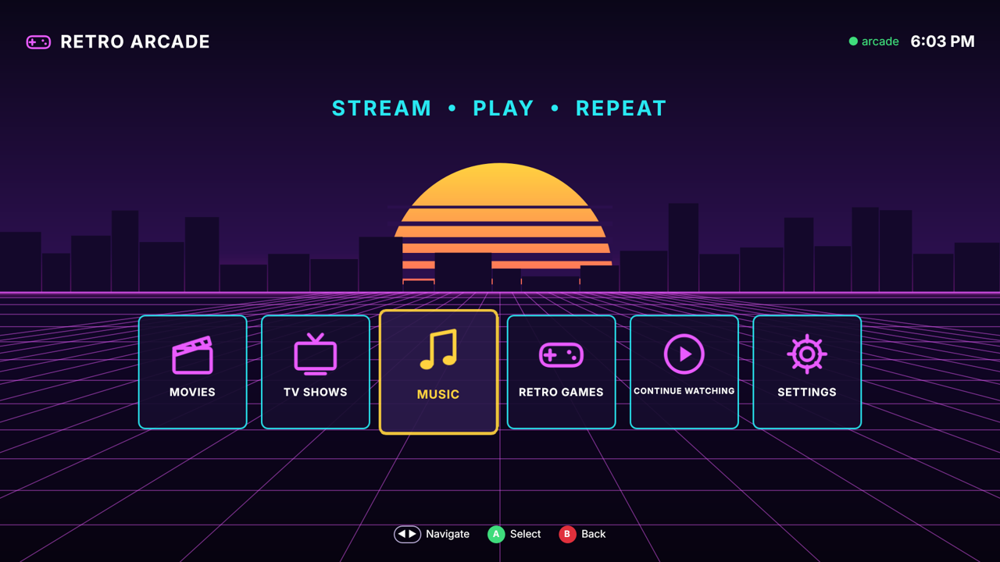

# Wave Culture Media Center

CM5-based TV media dongle: Buildroot OS, a Qt 6 "Wave Culture Media" home screen (Retro Arcade layout, blue theme) that browses and plays
from Jellyfin, and a FastAPI cloud backend for device settings and feature flags.



| Path | What |
|---|---|
| `device/cm5-os/app` | Qt 6 / QML home screen and Jellyfin client |
| `device/cm5-os/br2-external` | Buildroot external tree, config fragment, init script |
| `services/backend` | FastAPI cloud API (devices, settings, features) |
| `hardware/enclosure-v1.2` | Enclosure CAD (fit-check only) |
| `docs/` | Architecture, API contract (`openapi.json`), security, plan, acceptance |

```sh
bash scripts/verify.sh        # backend tests
bash scripts/verify.sh --qt   # plus Qt build, unit tests and QML smoke test
```

Status: see `CLAUDE.md`, `docs/MEDIA_CENTER.md` and `TEST_RESULTS.md`. Nothing here has been built
into a CM5 image or tested on hardware yet.

---

# Retro Arcade — Claude Handoff v0.3

Includes Buildroot CM5 OS starter, Qt 6 Retro Arcade media center source, cloud backend, CAD references, and engineering documentation.

**New in v0.3:** Jellyfin Qt/C++ client, Movies/TV/Music library browsing, Continue Watching request, image loading, initial direct-play with Qt Multimedia, and server/login settings screen.

**Not included:** bootable CM5 image, tested streaming pipeline, production-ready credentials, episode browser, complete Jellyfin playback negotiation, admin dashboard, RetroArch, secure updates. See `docs/MEDIA_CENTER.md` and `CLAUDE.md`.

The included code has been statically audited but not compiled with Qt/Buildroot in this environment.
