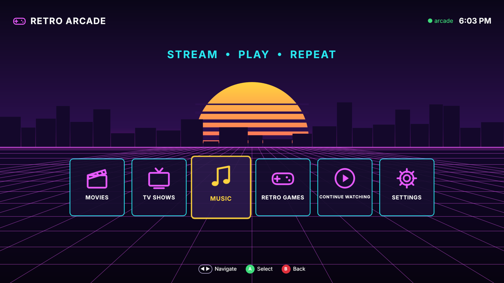
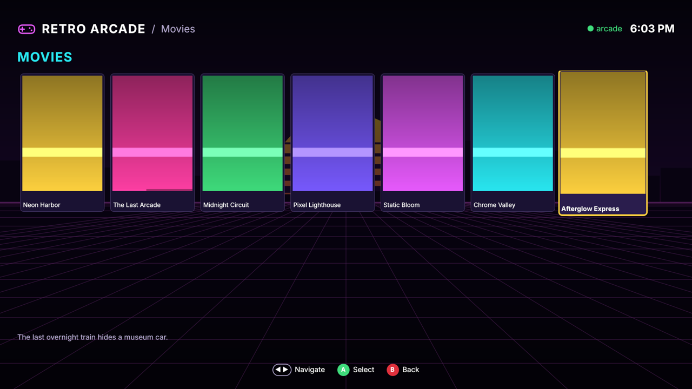
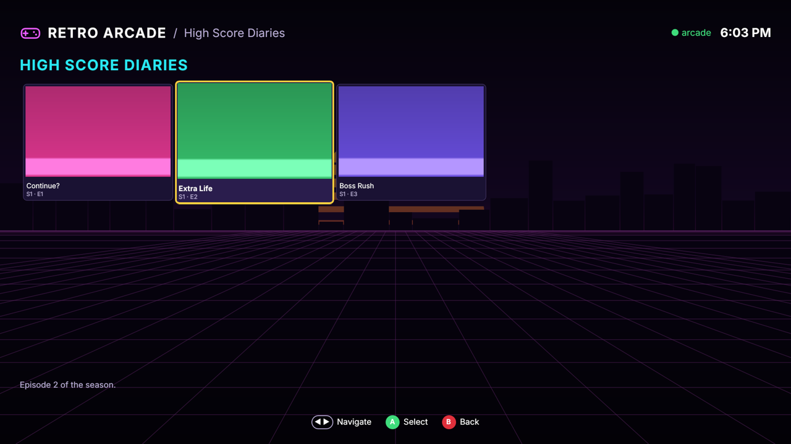
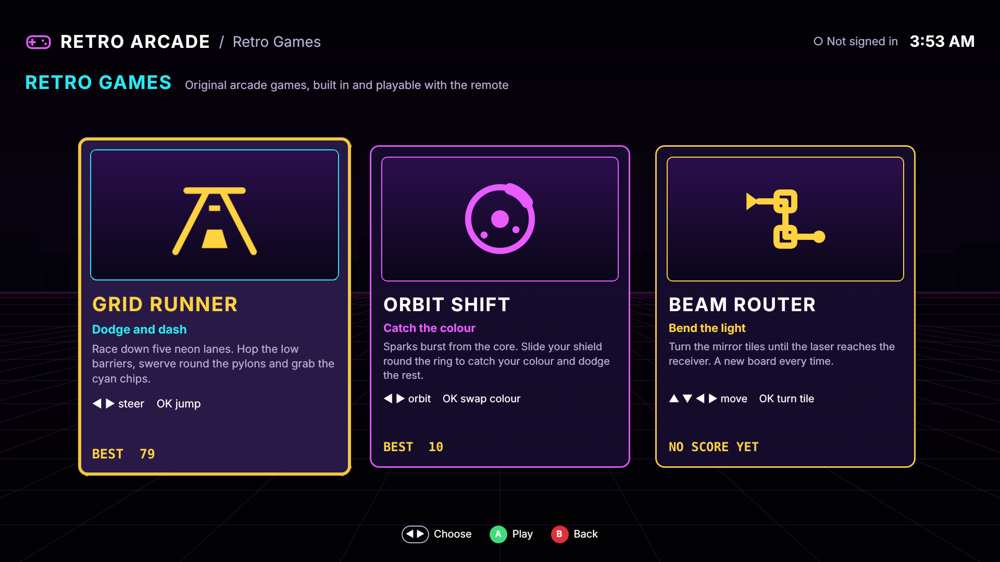
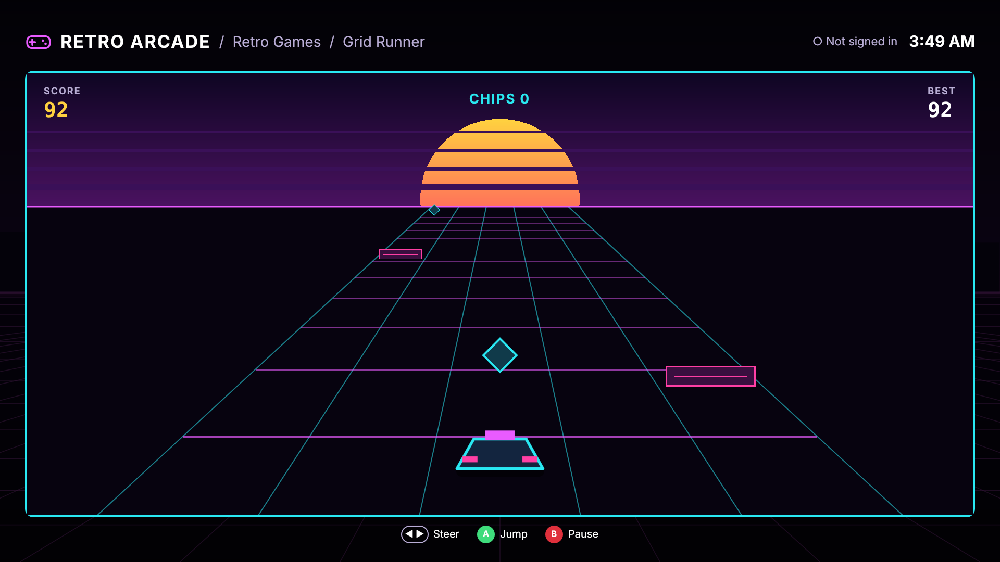
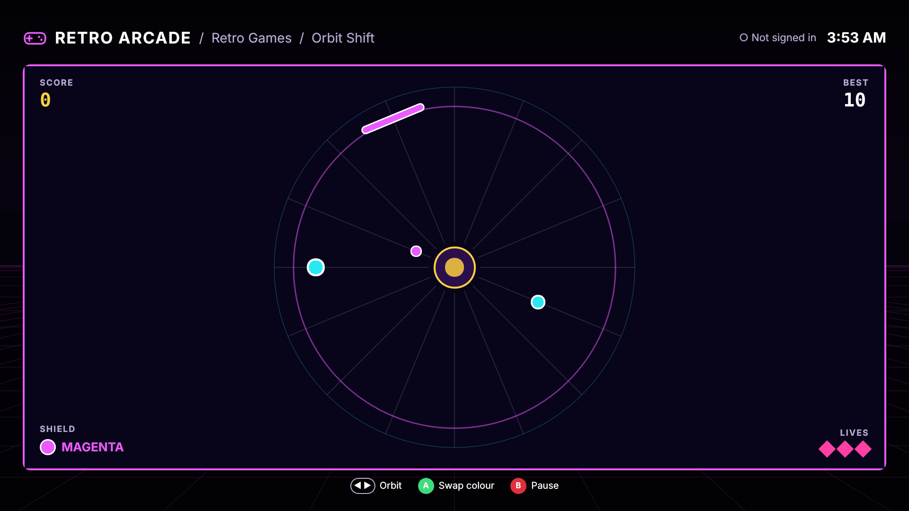
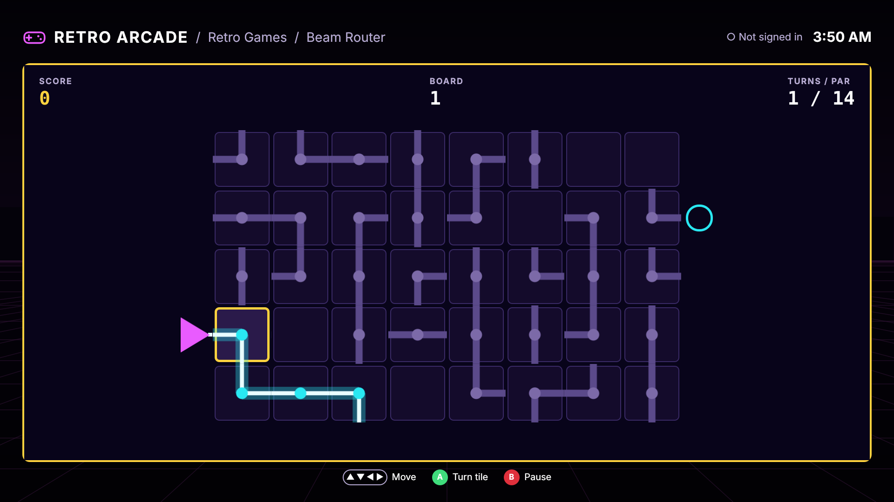

# Media Center v0.4 — implementation and limitations



Screenshots are from the desktop build (Qt 6.4, offscreen, 1920×1080) against
`device/cm5-os/tools/fake_jellyfin.py`. All titles and artwork in them are generated fakes.

| Movies | Episodes | Settings |
|---|---|---|
|  |  |  |

## Implemented source
- Retro Arcade theme (concept 2 in `reference/ui-six-concepts.png`): synthwave sun, skyline and
  perspective grid, neon tiles with yellow focus and scale animation, header clock and sign-in
  status, footer remote hints. Layout is authored at 1080p and scaled by window size.
- Home tiles: Movies, TV Shows, Music, Retro Games, Continue Watching, Settings.
- **Retro Games**: three original games built into the app (no emulator, no ROMs, no
  recreations of existing titles), all playable with D-pad + OK + Back:
  - *Grid Runner*: steer across five neon lanes, jump low barriers, dodge pylons, collect chips.
  - *Orbit Shift*: move a shield round a ring and catch sparks of your colour; OK swaps colour.
  - *Beam Router*: turn mirror tiles to route a laser to the receiver; boards are generated.

  Back pauses (Back again quits, OK resumes); leaving with Home also pauses. Best scores are kept
  per game on the device (QSettings group `games`, local only). Game rules live in plain JS
  (`app/qml/games/*.js`) with Node unit tests; rendering is Rectangles plus a few Canvases that
  repaint only on change, to stay cheap on the software scene graph. Not yet measured on the CM5.

  | Picker | Grid Runner | Orbit Shift | Beam Router |
  |---|---|---|---|
  |  |  |  |  |
- Jellyfin username/password login (`/Users/AuthenticateByName`), sign out (`/Sessions/Logout`).
- Requests authenticate with `Authorization: MediaBrowser Client=…, DeviceId=…, Token=…`.
- Per-installation random `DeviceId` (UUID), replacing the shared `cm5-prototype` id.
- Library browsing for movies, series and audio; Continue Watching via `/Items/Resume`.
- **Episode browsing**: selecting a series lists its episodes (`/Shows/{id}/Episodes`) with S/E labels.
- **Artwork without tokens in URLs**: `image://jellyfin/<id>` provider fetches with the auth header.
- **Playback negotiation** (`app/playbackprofile.cpp`): every play sends a CM5 `DeviceProfile` to
  `POST /Items/{id}/PlaybackInfo`. The server answers with direct play when the file fits the
  profile, otherwise with an HLS transcode to H.264/AAC in MPEG-TS segments. The profile mirrors
  the image's GStreamer plugins:

  | | Direct play |
  |---|---|
  | Containers | mp4/m4v/mov, mkv/webm, ts; audio mp3, flac, m4a |
  | Video | h264 (8-bit), hevc (Main/Main 10), vp8, vp9, mpeg4, mpeg2video, up to 1920×1080 |
  | Audio | aac, mp3, ac3, eac3, flac, opus, vorbis, alac, dts, up to 6 channels |
  | Everything else | server transcode (for example AV1, VC-1, AVI, 4K, 10-bit H.264, WMA) |

  The 1080p cap is a guess for software decode (the image has no v4l2codecs yet, so even HEVC is
  decoded on the CPU) and needs measuring on the CM5.
- **Transcode fallback**: if direct play fails on the device (GStreamer cannot open or decode the
  stream, or a video plays without a picture), the player asks the server once more with direct
  play disabled and continues from the same position over HLS. The player shows DIRECT PLAY or
  SERVER TRANSCODE next to the progress bar.
- Resume from `PlaybackPositionTicks`, and progress sync (`/Sessions/Playing`, `/Progress` every
  10 s, `/Stopped`) with the real `PlayMethod`, `PlaySessionId` and `MediaSourceId`. Stopping a
  transcode also calls `DELETE /Videos/ActiveEncodings` so the server ends the ffmpeg job.
- Player: OK pause/play, Left/Right seek 10 s, media keys, Back stops and reports position.
  The player is created on demand, so the home UI still starts if the multimedia backend is broken.
- Settings page reachable entirely by D-pad (Up/Down between fields, OK to connect, Esc/Back to leave).
- **Cloud pairing** (Settings → Arcade Cloud): shows a pairing code, polls until approved, stores
  the device token, then fetches bootstrap settings and feature flags and sends a heartbeat every
  5 minutes. Tiles for features the cloud disables are hidden; offline devices keep their last
  settings. A revoked device returns to "not paired". Once paired, Jellyfin uses the cloud device id.

  
- Server URL validation (http/https only, no user-info), base path kept for reverse proxies,
  token dropped whenever the server changes, session-expired (401) handling.

## Critical incomplete items
- Retro Games frame rate and input feel on the CM5 (software rendering, real remote) are untested.
  RetroArch and legal game import remain a later milestone.
- **Not built by Buildroot or run on the CM5.** The Kconfig fragment now resolves cleanly against
  the pinned Buildroot (see `device/cm5-os/docs/BOOT_AND_TEST.md`) but no image has been compiled.
- Playback negotiation is tested against the fake server's imitation of Jellyfin's StreamBuilder
  and real streams on desktop GStreamer, **not against a real Jellyfin server or on the CM5**. The
  direct-play limits are unmeasured. No subtitles (none are requested, so none are burned in),
  no audio or version picker (the first media source is used), no bitrate setting.
- The CM5 has no H.264 hardware decoder; HEVC hardware decode needs v4l2codecs and udev.
- The **stream URL still carries the token as `api_key`**, because Qt Multimedia's `MediaPlayer`
  cannot send request headers. Never log player URLs. Options: a local authenticating proxy, or a
  short-lived stream token from the cloud API once device pairing exists.
- QSettings token persistence is not secure credential storage. Replace with the device credential service.
- No seasons view (episodes are listed flat per series), no music-focused UI, search, favourites or profiles.
- Text entry needs a TV on-screen keyboard; today the Settings fields require a keyboard.
- Remote HID mapping beyond keyboard-equivalent keys (arrows, Enter, Esc, media keys) is not implemented.
- The app still authenticates directly to Jellyfin; it does not use the cloud as an authorization gateway.
- Cloud device token storage is QSettings (prototype); the bootstrap `theme` setting is read but only the Retro Arcade theme exists.

## Build and test on a desktop
```sh
sudo apt-get install qt6-base-dev qt6-declarative-dev qt6-multimedia-dev qt6-qpa-plugins \
  qml6-module-qtquick qml6-module-qtquick-controls qml6-module-qtquick-templates \
  qml6-module-qtquick-window qml6-module-qtmultimedia qml6-module-qtqml-workerscript \
  gstreamer1.0-plugins-base gstreamer1.0-plugins-good gstreamer1.0-plugins-bad \
  gstreamer1.0-libav gstreamer1.0-tools ffmpeg
bash scripts/verify.sh --qt          # backend tests + Qt build, unit tests, playback, QML smoke test
device/cm5-os/tools/make_test_media.sh /tmp/arcade-media   # optional: real clips for playback
python3 device/cm5-os/tools/fake_jellyfin.py --port 8096 --media /tmp/arcade-media &
build/cm5-home-host/cm5-home         # Settings: http://127.0.0.1:8096, arcade / insert-coin
```
`CM5_HOME_SIZE=1920x1080` runs windowed; `CM5_HOME_SMOKE_MS`, `CM5_HOME_KEYS` and
`CM5_HOME_SCREENSHOT` script a run and save a screenshot (see `app/main.cpp`).

Without GStreamer base plugins, Ubuntu's Qt 6.4 crashes when a `MediaPlayer` is constructed.
That is why the player is loaded lazily, and why the device fragment selects the GStreamer plugins.

`tst_playerview` plays generated clips through `PlayerView.qml` (direct play, HLS transcode, and
a corrupt direct stream that must fall back to HLS). It skips itself without ffmpeg, hlsdemux or
gst-libav. On Ubuntu's Qt 6.4, destroying a playing pipeline that has a `VideoOutput` sometimes
corrupts the heap (the stock `qml` tool does it too), so the test leaks its players on purpose.

## Integration tests still to run (real server, real device)
1. Configure a test Jellyfin server with HTTPS and a test user; sign in via Settings.
2. Browse Movie, Series and Audio libraries; verify artwork and navigation.
3. Direct-play H.264/AAC MP4 and HEVC MKV; record A/V sync and CPU load, and tune the 1080p and
   bit-depth limits in `playbackprofile.cpp` from the numbers.
4. Confirm resume position, progress and the play method appear in the Jellyfin dashboard.
5. Play an AV1, a VC-1 and a 4K file; confirm the server transcodes, seeking works over HLS, and
   the transcode stops when Back is pressed.
6. Validate Wi-Fi reconnect, Bluetooth keyboard/remote events and long-duration playback.
7. Audit tokens, TLS verification and server URL validation before production.
