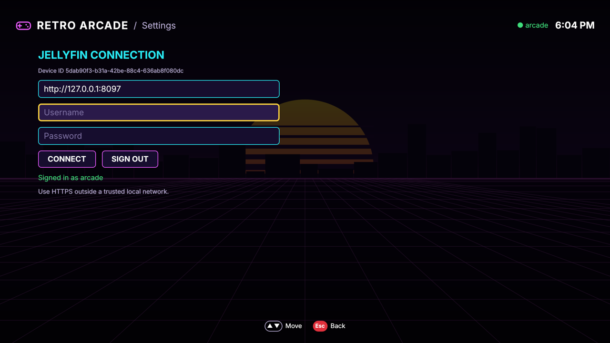
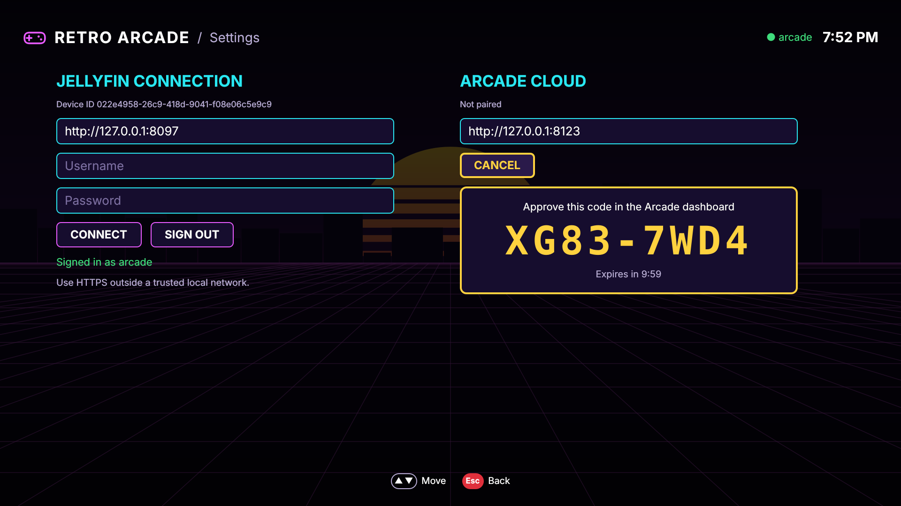

# Media Center v0.4 — implementation and limitations


Screenshots are from the desktop build (Qt 6.4, offscreen, 1920×1080) against
`device/cm5-os/tools/fake_jellyfin.py`. All titles and artwork in them are generated fakes.

| Movies | Episodes | Settings |
|---|---|---|
|  |  |  |

## Implemented source
- Retro Arcade theme (concept 2 in `reference/ui-six-concepts.png`): synthwave sun, skyline and
  perspective grid, neon tiles with yellow focus and scale animation, header clock and sign-in
  status, footer remote hints. Layout is authored at 1080p and scaled by window size.
- Home tiles: Movies, TV Shows, Music, Retro Games (placeholder), Continue Watching, Settings.
- Jellyfin username/password login (`/Users/AuthenticateByName`), sign out (`/Sessions/Logout`).
- Requests authenticate with `Authorization: MediaBrowser Client=…, DeviceId=…, Token=…`.
- Per-installation random `DeviceId` (UUID), replacing the shared `cm5-prototype` id.
- Library browsing for movies, series and audio; Continue Watching via `/Items/Resume`.
- **Episode browsing**: selecting a series lists its episodes (`/Shows/{id}/Episodes`) with S/E labels.
- **Artwork without tokens in URLs**: `image://jellyfin/<id>` provider fetches with the auth header.
- Direct-play stream URL (`/Videos|Audio/{id}/stream?static=true`), resume from
  `PlaybackPositionTicks`, and progress sync (`/Sessions/Playing`, `/Progress` every 10 s, `/Stopped`).
- Player: OK pause/play, Left/Right seek 10 s, media keys, Back stops and reports position.
  The player is created on demand, so the home UI still starts if the multimedia backend is broken.
- Settings page reachable entirely by D-pad (Up/Down between fields, OK to connect, Esc/Back to leave).
- **Cloud pairing** (Settings → Arcade Cloud): shows a pairing code, polls until approved, stores
  the device token, then fetches bootstrap settings and feature flags and sends a heartbeat every
  5 minutes. Tiles for features the cloud disables are hidden; offline devices keep their last
  settings. A revoked device returns to "not paired". Once paired, Jellyfin uses the cloud device id.

  
- Server URL validation (http/https only, no user-info), base path kept for reverse proxies,
  token dropped whenever the server changes, session-expired (401) handling.

## Critical incomplete items
- **Not built by Buildroot or run on the CM5.** The Kconfig fragment now resolves cleanly against
  the pinned Buildroot (see `device/cm5-os/docs/BOOT_AND_TEST.md`) but no image has been compiled.
- Direct play only: no PlaybackInfo negotiation, codec checks, subtitles or transcoding. Files the
  CM5 cannot decode will fail with an on-screen error. The CM5 has no H.264 hardware decoder.
- The **stream URL still carries the token as `api_key`**, because Qt Multimedia's `MediaPlayer`
  cannot send request headers. Never log player URLs. Options: a local authenticating proxy, or a
  short-lived stream token from the cloud API once device pairing exists.
- QSettings token persistence is not secure credential storage. Replace with the device credential service.
- No seasons view (episodes are listed flat per series), no music-focused UI, search, favourites or profiles.
- Text entry needs a TV on-screen keyboard; today the Settings fields require a keyboard.
- Remote HID mapping beyond keyboard-equivalent keys (arrows, Enter, Esc, media keys) is not implemented.
- The app still authenticates directly to Jellyfin; it does not use the cloud as an authorization gateway.
- Cloud device token storage is QSettings (prototype); the bootstrap `theme` setting is read but only the Retro Arcade theme exists.

## Build and test on a desktop
```sh
sudo apt-get install qt6-base-dev qt6-declarative-dev qt6-multimedia-dev qt6-qpa-plugins \
  qml6-module-qtquick qml6-module-qtquick-controls qml6-module-qtquick-templates \
  qml6-module-qtquick-window qml6-module-qtmultimedia qml6-module-qtqml-workerscript \
  gstreamer1.0-plugins-base gstreamer1.0-plugins-good
bash scripts/verify.sh --qt          # backend tests + Qt build, unit tests, QML smoke test
python3 device/cm5-os/tools/fake_jellyfin.py --port 8096 &
build/cm5-home-host/cm5-home         # Settings: http://127.0.0.1:8096, arcade / insert-coin
```
`CM5_HOME_SIZE=1920x1080` runs windowed; `CM5_HOME_SMOKE_MS`, `CM5_HOME_KEYS` and
`CM5_HOME_SCREENSHOT` script a run and save a screenshot (see `app/main.cpp`).

Without GStreamer base plugins, Ubuntu's Qt 6.4 crashes when a `MediaPlayer` is constructed.
That is why the player is loaded lazily, and why the device fragment selects the GStreamer plugins.

## Integration tests still to run (real server, real device)
1. Configure a test Jellyfin server with HTTPS and a test user; sign in via Settings.
2. Browse Movie, Series and Audio libraries; verify artwork and navigation.
3. Direct-play H.264/AAC MP4 and HEVC MKV; record A/V sync and CPU load.
4. Confirm resume position and progress appear in the Jellyfin dashboard.
5. Test an unsupported codec to document the fallback need.
6. Validate Wi-Fi reconnect, Bluetooth keyboard/remote events and long-duration playback.
7. Audit tokens, TLS verification and server URL validation before production.
